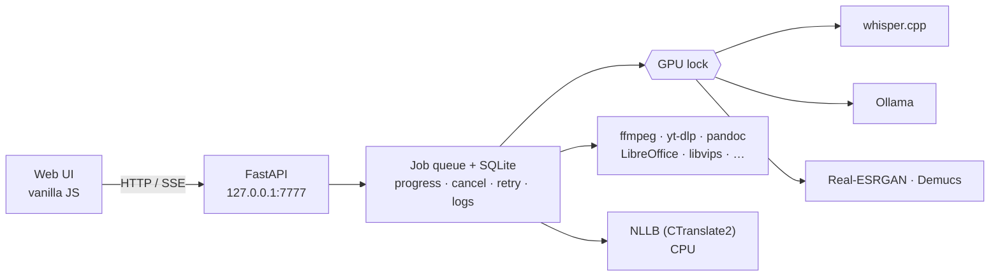

<div align="center">


# Atelier

**Un hub local, utilisable hors ligne, pour la traduction, les médias et les documents.**<br>
Un petit service sur votre machine. Vos textes et fichiers ne la quittent jamais.

[](https://github.com/kerstz/atelier-hub/actions/workflows/ci.yml)
[](LICENSE)


Français · [English](README.md)


</div>

> **Vibe coding.** L'essentiel de ce projet a été écrit avec des assistants de code IA (Claude Code), à partir de prompts plutôt qu'à la main. Lisez le code avant de lui confier quoi que ce soit de sensible.

---

Atelier enveloppe des outils en ligne de commande éprouvés (ffmpeg, yt-dlp, whisper.cpp, Ollama, pdf2zh-next,
Piper, Demucs…) derrière une seule interface web, une file de tâches et un verrou GPU global — **au lieu de les
réimplémenter**. Il n'écoute que sur `127.0.0.1`, n'a ni étape de build ni CDN, et continue de fonctionner
sans réseau.

## L'essentiel

- **Traduire** texte, sous-titres, PDF, fichiers Office et EPUB avec des modèles locaux — 35 langues, variantes
  expliquées (portugais PT/BR, chinois simplifié/traditionnel, philippin vs cebuano…).
- **S'adapte à votre matériel** : choisit les modèles selon votre GPU/RAM, et bascule sur **NLLB-200 en CPU**
  pour qu'un petit PC traduise quand même.
- **Résultats dans l'app** : voir sous-titres/texte, aperçu d'images, lecture audio/vidéo (H.264/AAC préparé et mis en cache, sous-titres, repli mpv).
- **Tout dans une file** : progression SSE, annulation, relance, journal par tâche, notifications de bureau,
  une tâche GPU à la fois (modèles déchargés avant les jobs GPU hors Ollama).
- **Fenêtre native ou navigateur** : fenêtre pywebview optionnelle avec entrée de menu, reprise sur crash et
  repli navigateur.
- **Privé par construction** : loopback uniquement, contrôles de même origine, aucune commande shell
  construite depuis l'UI, écritures confinées à `~/Atelier` et au dossier de données.

## Au programme

| Onglet | Contenu |
|---|---|
| **Traduire** | Texte libre avec contexte entre blocs et glossaires · image → texte → traduction (modèle vision) · dictée (micro → whisper.cpp) · lecture à voix haute / export MP3 (Piper) |
| **YouTube** | Vidéo ou playlist → mkv / mp3 / sous-titres seuls, choix de qualité, progression réelle |
| **Sous-titres** | URL ou média/SRT local → sous-titres existants, sinon whisper.cpp → SRT traduit (+ mkv soft-sub) · résumé du transcript avec chapitres horodatés |
| **Documents** | PDF (pdf2zh-next, mono + bilingue, OCR automatique des scans) · DOCX / PPTX / XLSX avec mise en forme inline conservée · EPUB avec table des matières + métadonnées conservées |
| **Convertir** | Vidéo/audio (ffmpeg, VAAPI h264/hevc, AV1 en CPU) · images (libvips) · documents (pandoc + LibreOffice) · e-books (calibre) · lot + zip · mode navigateur optionnel ([VERT](https://github.com/VERT-sh/VERT), `scripts/build-vert.sh`) |
| **Images** | Agrandissement ×2 / ×4 (Real-ESRGAN, Vulkan) · détourage (rembg) |
| **Audio** | Séparation des pistes (Demucs) · réduction du bruit de la voix (DeepFilterNet) · **changeur de voix**: 15 voix zéro-shot FR/EN (Seed-VC, GPU) + effets, sur fichiers ou en direct vers un micro virtuel PipeWire — voir [docs/VOICES.md](docs/VOICES.md) |
| **Services** | Sonde, démarrage et arrêt de vos autres services locaux (Open WebUI, Jellyfin…) |
| **Système** | VRAM, modèles chargés, profil matériel, dépendances avec commandes d'installation, espace disque et nettoyage |

## Galerie

<table>
  <tr>
    <td><br><sub><b>Convertir</b> — déposez n'importe quoi, choisissez la cible, lot en zip</sub></td>
    <td><br><sub><b>Documents</b> — PDF, Office et EPUB, mise en page conservée</sub></td>
  </tr>
  <tr>
    <td><br><sub><b>Sous-titres</b> — sous-titres existants ou whisper.cpp, puis traduction</sub></td>
    <td><br><sub><b>YouTube</b> — vidéo, audio ou sous-titres, playlists comprises</sub></td>
  </tr>
  <tr>
    <td><br><sub><b>Images</b> — agrandissement et détourage</sub></td>
    <td><br><sub><b>Audio</b> — pistes et réduction du bruit</sub></td>
  </tr>
  <tr>
    <td><br><sub><b>Système</b> — profil matériel, dépendances, disque</sub></td>
    <td><br><sub><b>Thème clair</b> — suit le système, modifiable</sub></td>
  </tr>
</table>

## Démarrage rapide

```bash
git clone https://github.com/kerstz/atelier-hub && cd atelier-hub
./install.sh --dry-run             # affiche le plan pour votre distro, ne change rien
./install.sh                       # niveau standard (demande confirmation avant d'agir)
```

Puis ouvrir <http://127.0.0.1:7777>. `install.sh` détecte Arch/CachyOS/Manjaro (pacman), Debian/Ubuntu/Mint
(apt), Fedora/Nobara (dnf) et openSUSE (zypper). Options : `--tier=minimal|standard|full`, `--yes`,
`--dry-run`, `--no-whisper`, `--no-desktop`, `--no-service`, `--ollama`, `--models` (télécharge les modèles
Ollama recommandés pour *votre* matériel), `--engine=ct2` (traduction CPU pour petites machines).

| Niveau | Ajoute |
|---|---|
| `minimal` | ffmpeg, yt-dlp, poppler, uv, le service — traduction, YouTube, sous-titres existants |
| `standard` (défaut) | OCR, pandoc, LibreOffice, libvips, whisper.cpp (build Vulkan), pdf2zh-next, entrée de menu |
| `full` | calibre, Piper, rembg, Demucs, Real-ESRGAN, DeepFilterNet |

Voie manuelle (toute distro) : `bash scripts/env-check.sh`, `uv sync --frozen`, `bash scripts/install-service.sh`,
puis éventuellement `bash scripts/install-desktop.sh`. Atelier ne télécharge ni n'installe rien sans l'avoir
listé d'abord.

### Optionnel : convertisseur dans le navigateur (VERT)

Le second mode de Convertir, **Navigateur**, intègre [VERT](https://github.com/VERT-sh/VERT) (images, audio,
documents, en WebAssembly, rien ne quitte la page). Il est construit depuis les sources sur votre machine, figé
sur un commit testé, puis servi hors-ligne sur `/vert/` :

```bash
bash scripts/build-vert.sh           # git + bun (ou node/npm), quelques minutes, ~100 Mo
systemctl --user restart atelier
```

Linux uniquement ; la vidéo reste dans le mode ffmpeg habituel. Sans build, le sélecteur de mode n'apparaît pas.
VERT est sous AGPL-3.0 : il n'est pas inclus dans le `.deb`/`.exe`, seulement construit en local.

## Windows (expérimental)

Même application, empaquetée en `Atelier.exe` (PyInstaller + fenêtre WebView2, installeur Inno Setup). Build sous Windows :
`powershell -ExecutionPolicy Bypass -File scripts\build-win.ps1` ; outils manquants via `scripts\win-setup.ps1` (winget).
Config : `%APPDATA%\Atelier\config.toml`, données : `%LOCALAPPDATA%\Atelier`. Indisponible sous Windows : voix en direct
(micro virtuel PipeWire), notifications, services systemd (les services docker compose marchent). Pas encore testé sur un vrai
Windows ; la CI construit l'exe et vérifie qu'il répond.

## Adaptation au matériel

Atelier profile la machine (VRAM GPU — AMD/NVIDIA —, RAM, cœurs, AVX2) et choisit les modèles par rôle :

| Machine | Traduction | Texte / résumé | Vision |
|---|---|---|---|
| GPU ≥ 24 Go | `translategemma:27b` | `gemma3:27b` | `gemma3:27b` |
| GPU 14–24 Go | `translategemma:12b` | `gemma3:12b` | `gemma3:12b` |
| GPU 3,5–14 Go | `translategemma:4b` | `gemma3:4b` | `gemma3:4b` |
| CPU seul, ≥ 15 Go de RAM | NLLB-200 1.3B (CTranslate2) | `gemma3:4b` | `gemma3:4b` |
| Petite machine | NLLB-200 600M (CTranslate2) | `gemma3:1b` | — |

Voir **Système → Matériel**, `python -m atelier.hw` et `[translate] engine` dans `config.toml` (`auto` ne choisit
que parmi ce qui est déjà installé ; les réglages explicites gagnent toujours). Les poids NLLB sont CC-BY-NC ;
avec le moteur CPU la traduction de PDF est indisponible (pdf2zh exige Ollama).

## Fonctionnement



Détails dans [docs/ARCHITECTURE.md](docs/ARCHITECTURE.md) (en anglais).

## Configuration

Tout est dans [`config.toml`](config.toml) : ports et chemins, modèles et moteur, voix, limites d'envoi,
comportement GPU, services. L'interface est en français ou en anglais (bouton dans la barre latérale ; suit
la langue du navigateur par défaut).

## Développement

```bash
uv sync --frozen
uv run python -m atelier                 # http://127.0.0.1:7777
bash scripts/smoke-all.sh --quick        # suite smoke hors ligne (aucun modèle requis)
bash scripts/smoke-all.sh                # complet : Ollama, whisper.cpp, réseau
```

Pas de framework de test, volontairement — un script smoke par domaine dans `scripts/`. Voir
[CONTRIBUTING.md](CONTRIBUTING.md).

## Sécurité

Mono-utilisateur, local uniquement. Atelier écoute sur loopback, refuse les en-têtes `Host`/`Origin` étrangers
(même origine seulement, y compris les autres applications web locales), ne construit jamais de commande shell
depuis l'UI et garde ses écritures dans `~/Atelier` et son dossier de données. Le build VERT optionnel est du code
de même origine : il est donc figé et jamais téléchargé à l'exécution. **Ne pas l'exposer sur un
réseau.** Détails et signalement : [SECURITY.md](SECURITY.md).

## Remerciements

Atelier repose sur [ffmpeg](https://ffmpeg.org), [yt-dlp](https://github.com/yt-dlp/yt-dlp),
[whisper.cpp](https://github.com/ggml-org/whisper.cpp), [Ollama](https://ollama.com),
[pdf2zh-next](https://github.com/PDFMathTranslate/PDFMathTranslate-next), [OCRmyPDF](https://ocrmypdf.readthedocs.io),
[Piper](https://github.com/OHF-Voice/piper1-gpl), [Real-ESRGAN](https://github.com/xinntao/Real-ESRGAN),
[Demucs](https://github.com/adefossez/demucs), [rembg](https://github.com/danielgatis/rembg),
[DeepFilterNet](https://github.com/Rikorose/DeepFilterNet), [libvips](https://www.libvips.org),
[pandoc](https://pandoc.org), [LibreOffice](https://www.libreoffice.org), [calibre](https://calibre-ebook.com),
[CTranslate2](https://github.com/OpenNMT/CTranslate2) avec [NLLB-200](https://github.com/facebookresearch/fairseq/tree/nllb),
[FastAPI](https://fastapi.tiangolo.com) et [pywebview](https://pywebview.flowrl.com). Les icônes viennent de
[Lucide](https://lucide.dev) (ISC). La conversion dans le navigateur est [VERT](https://github.com/VERT-sh/VERT) (AGPL-3.0).

## License

[MIT](LICENSE) pour Atelier lui-même. Les outils et modèles pilotés ont leurs propres licences (notamment
NLLB-200 : CC-BY-NC ; Piper 1.x : GPL-3 ; VERT : AGPL-3.0, construit localement depuis les sources et non redistribué avec Atelier).
