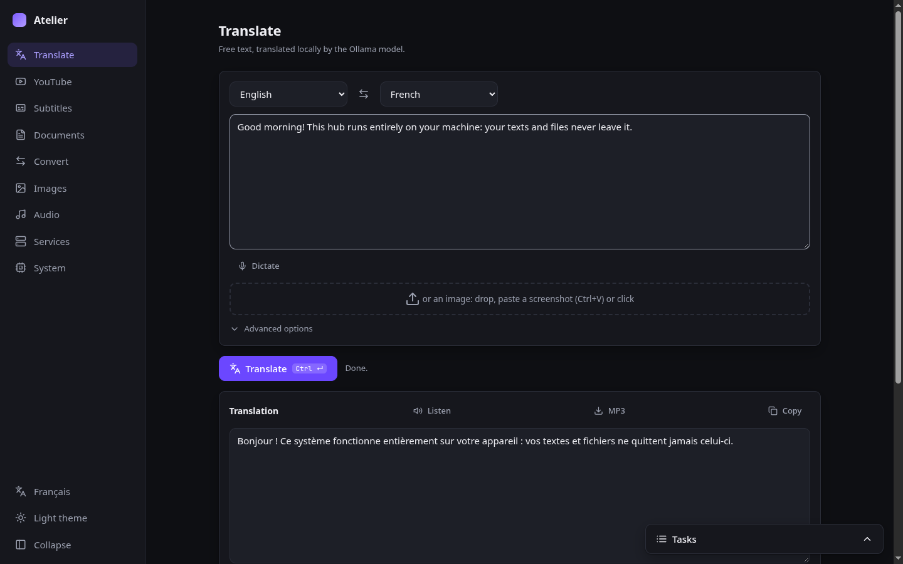
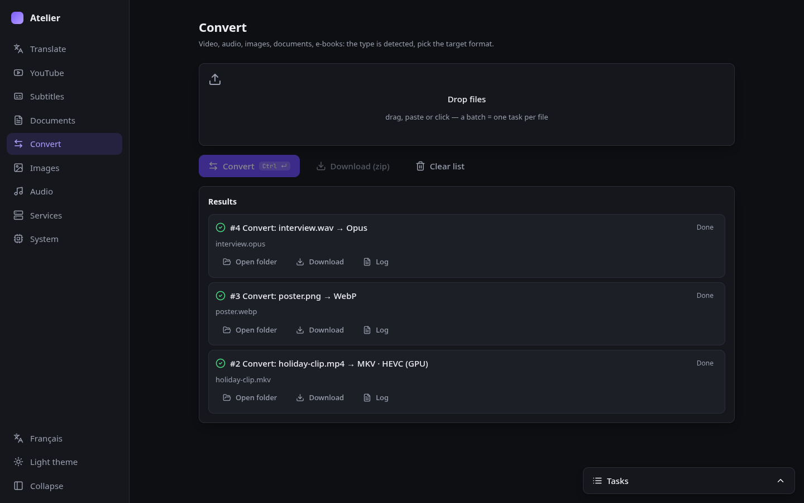
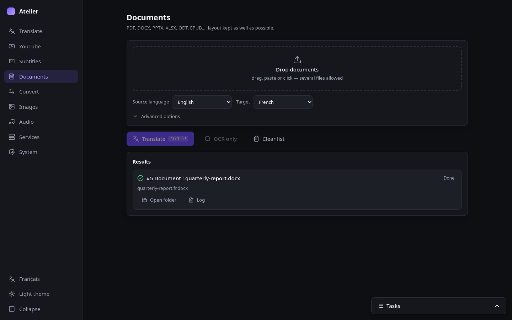
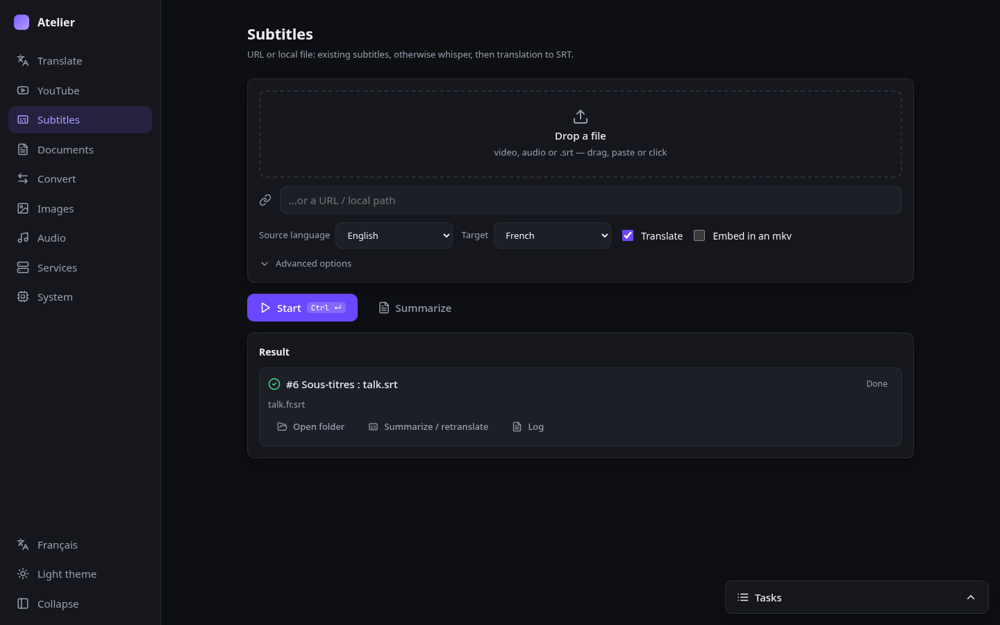
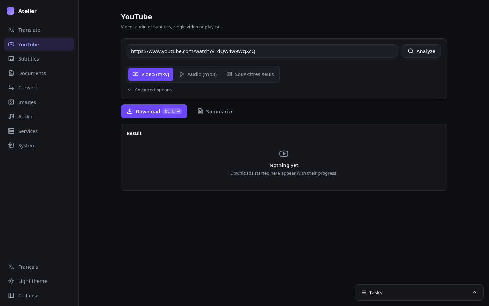
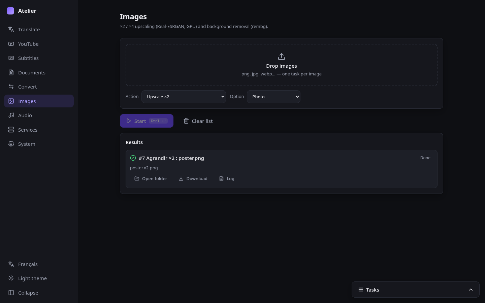
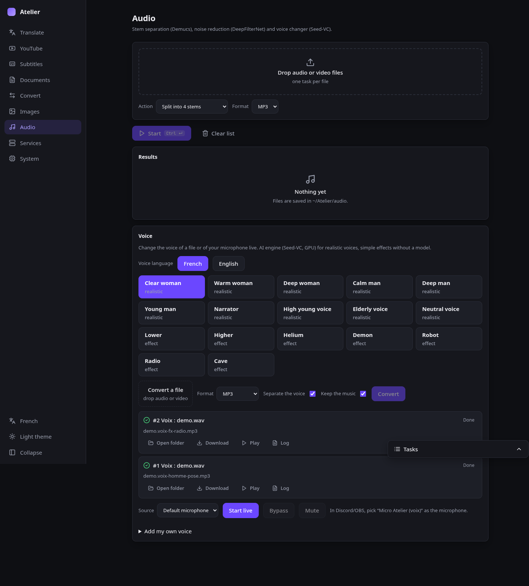
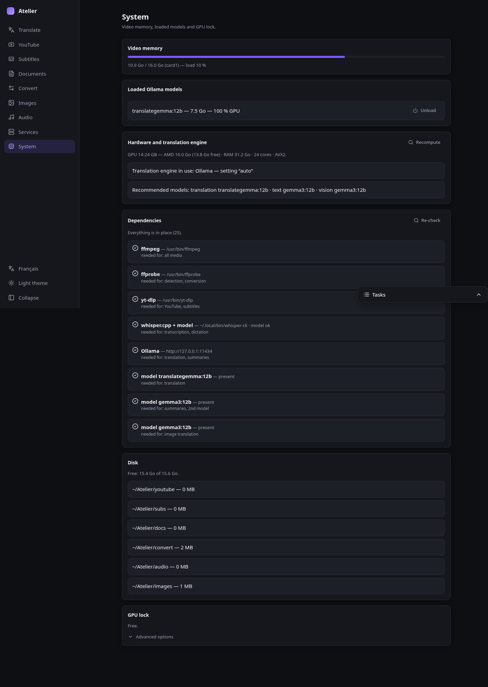
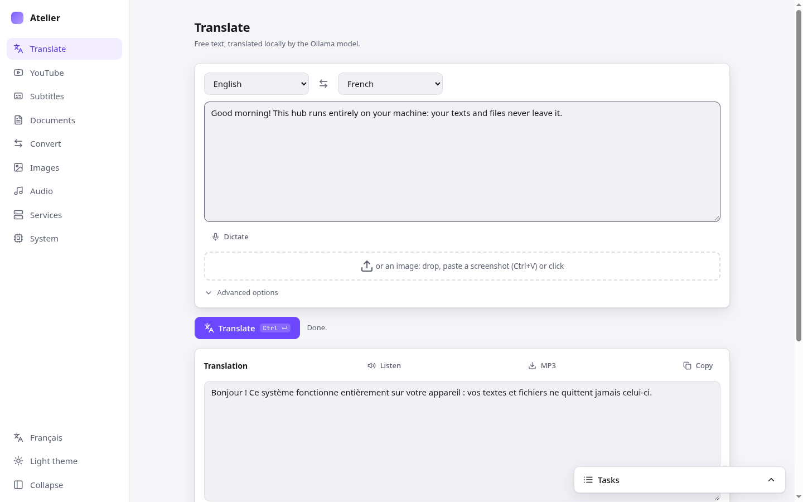
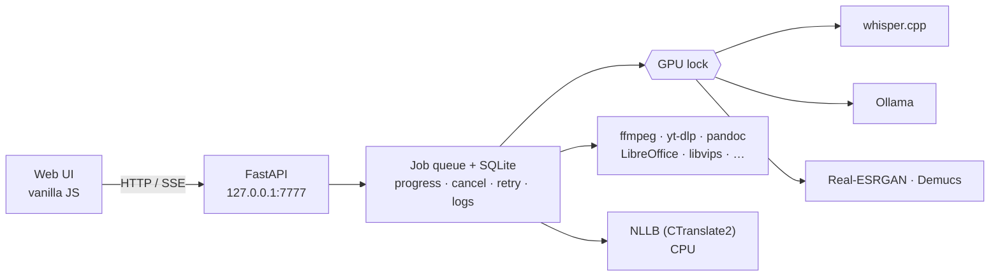

<div align="center">


# Atelier

**A local, offline-first hub for translation, media and documents.**<br>
One small service on your machine. Your texts and files never leave it.

[](https://github.com/kerstz/atelier-hub/actions/workflows/ci.yml)
[](LICENSE)


[Français](README.fr.md) · English



</div>

> **Vibe coded.** Most of this project was written with AI coding assistants (Claude Code), guided by prompts rather than hand-written. Read the code before relying on it for anything sensitive.

---

Atelier wraps battle-tested command-line tools (ffmpeg, yt-dlp, whisper.cpp, Ollama, pdf2zh-next, Piper,
Demucs…) behind a single clean web UI, a job queue and a global GPU lock — **instead of reimplementing
them**. It binds to `127.0.0.1` only, has no build step and no CDN, and keeps working when the network is
down.

## Highlights

- **Translate** text, subtitles, PDFs, Office files and EPUBs with local models — 35 languages, with
  variants explained (Portuguese PT/BR, Chinese simplified/traditional, Filipino vs Cebuano…).
- **Adapts to your hardware**: picks models for your GPU/RAM, and falls back to **NLLB-200 on CPU** so a
  small PC still translates.
- **Results inside the app**: view subtitles/text, preview images, play audio/video (H.264/AAC prepared and cached, subtitles, mpv fallback).
- **Everything in one queue**: progress over SSE, cancel, retry, per-job logs, desktop notifications, one GPU
  job at a time (models are unloaded before non-Ollama GPU jobs).
- **Native window or browser**: optional pywebview window with a menu entry, crash recovery and a browser
  fallback.
- **Private by construction**: loopback only, same-origin checks, no shell built from UI input, writes
  confined to `~/Atelier` and the data directory.

## What's inside

| Tab | What it does |
|---|---|
| **Translate** | Free text with cross-block context and glossaries · image → text → translation (vision model) · dictation (mic → whisper.cpp) · read aloud / export MP3 (Piper) |
| **YouTube** | Video or playlist → mkv / mp3 / subtitles only, quality choice, real progress |
| **Subtitles** | URL or local media/SRT → existing subtitles, else whisper.cpp → translated SRT (+ soft-sub mkv) · transcript summary with timestamped chapters |
| **Documents** | PDF (pdf2zh-next, mono + bilingual, automatic OCR for scans) · DOCX / PPTX / XLSX with inline formatting kept · EPUB with TOC + metadata kept |
| **Proofreader** | Spelling + grammar as you type, fully local: English with [Harper](https://github.com/Automattic/harper) (WASM in the browser), French and other languages with [LanguageTool](https://languagetool.org) |
| **Convert** | Video/audio (ffmpeg, VAAPI h264/hevc, AV1 on CPU) · images (libvips) · documents (pandoc + LibreOffice) · e-books (calibre) · batch + zip · optional in-browser mode ([VERT](https://github.com/VERT-sh/VERT), `scripts/build-vert.sh`) |
| **Images** | Upscale ×2 / ×4 (Real-ESRGAN, Vulkan) · background removal (rembg) · watermark area removal (ffmpeg delogo) |
| **Audio** | Stem separation (Demucs) · voice denoising (DeepFilterNet) · **voice changer**: 15 zero-shot voices FR/EN (Seed-VC, GPU) + effects, on files or live to a virtual PipeWire mic — see [docs/VOICES.md](docs/VOICES.md) |
| **Services** | Probe, start and stop your other local services (Open WebUI, Jellyfin…) |
| **System** | VRAM, loaded models, hardware profile, dependency check with install commands, disk usage and cleanup |

## Gallery

<table>
  <tr>
    <td><br><sub><b>Convert</b> — drop anything, pick a target, batch to zip</sub></td>
    <td><br><sub><b>Documents</b> — PDF, Office and EPUB with layout kept</sub></td>
  </tr>
  <tr>
    <td><br><sub><b>Subtitles</b> — existing captions or whisper.cpp, then translate</sub></td>
    <td><br><sub><b>YouTube</b> — video, audio or subtitles, playlists included</sub></td>
  </tr>
  <tr>
    <td><br><sub><b>Images</b> — upscaling and background removal</sub></td>
    <td><br><sub><b>Audio</b> — stems and voice denoising</sub></td>
  </tr>
  <tr>
    <td><br><sub><b>System</b> — hardware profile, dependencies, disk</sub></td>
    <td><br><sub><b>Light theme</b> — follows your system, switchable</sub></td>
  </tr>
</table>

## Quick start

```bash
git clone https://github.com/kerstz/atelier-hub && cd atelier-hub
./install.sh --dry-run             # print the plan for your distro, change nothing
./install.sh                       # standard tier (asks before doing anything)
```

Then open <http://127.0.0.1:7777>. `install.sh` detects Arch/CachyOS/Manjaro (pacman), Debian/Ubuntu/Mint
(apt), Fedora/Nobara (dnf) and openSUSE (zypper). Options: `--tier=minimal|standard|full`, `--yes`,
`--dry-run`, `--no-whisper`, `--no-desktop`, `--no-service`, `--ollama`, `--models` (pulls the Ollama models
recommended for *your* hardware), `--engine=ct2` (CPU translation for small machines).

| Tier | Adds |
|---|---|
| `minimal` | ffmpeg, yt-dlp, poppler, uv, the service — translate, YouTube, subtitles with existing captions |
| `standard` (default) | OCR, pandoc, LibreOffice, libvips, whisper.cpp (Vulkan build), pdf2zh-next, desktop entry |
| `full` | calibre, Piper, rembg, Demucs, Real-ESRGAN, DeepFilterNet |

Manual route (any distro): `bash scripts/env-check.sh`, `uv sync --frozen`, `bash scripts/install-service.sh`,
optionally `bash scripts/install-desktop.sh`. Nothing is downloaded or installed by Atelier itself without
being listed first.

### Optional: in-browser converter (VERT)

Convert's second mode, **Navigateur**, embeds [VERT](https://github.com/VERT-sh/VERT) (images, audio, documents,
in WebAssembly, nothing leaves the page). It is built from source on your machine, pinned to a tested commit,
then served offline from `/vert/`:

```bash
bash scripts/build-vert.sh           # needs git + bun (or node/npm), a few minutes, ~100 MB
systemctl --user restart atelier
```

Linux only; video stays in the regular ffmpeg mode. Without the build, the mode selector simply doesn't appear.
VERT is AGPL-3.0: it is not bundled in the `.deb`/`.exe`, only built locally.

### Proofreader (Harper + LanguageTool)

English runs in the browser with [Harper](https://github.com/Automattic/harper) (Apache-2.0, English only: no French
support upstream). French (and es/de/pt/it) uses a local [LanguageTool](https://languagetool.org) server (LGPL), started
on demand on `127.0.0.1:8081` and stopped after 10 idle minutes. Harper is built locally, not bundled.

```bash
sudo pacman -S languagetool          # French + other languages
bash scripts/build-harper.sh         # optional: English via Harper (npm, ~20 MB wasm)
systemctl --user restart atelier
```

Other systems: the `.exe` and `.deb` releases already embed Harper. French needs Java + LanguageTool:
Windows `scripts\get-languagetool.ps1` (also run by `win-setup.ps1`), Linux without the package `bash scripts/get-languagetool.sh`,
macOS `brew install languagetool` (see the macOS section).

## Windows (experimental)

Same app, packaged as `Atelier.exe` (PyInstaller + WebView2 window, Inno Setup installer). Build on Windows:
`powershell -ExecutionPolicy Bypass -File scripts\build-win.ps1`; missing tools via `scripts\win-setup.ps1` (winget).
Config: `%APPDATA%\Atelier\config.toml`, data: `%LOCALAPPDATA%\Atelier`. Not available on Windows: live voice changer
(PipeWire virtual mic), desktop notifications, systemd services (docker compose services work). Not tested on real
Windows yet; CI builds the exe and checks that it serves.

## macOS (experimental)

Same app from source, through Homebrew. Run `./install.sh` (it calls `scripts/install-mac.sh`; Homebrew required, https://brew.sh).
Apple Silicon is recommended: Ollama and whisper.cpp use Metal. Intel Macs run on CPU only (slow, but they work).
Autostart is a launchd agent (`fr.atelier`, written by `scripts/install-service.sh`); restart it with
`launchctl kickstart -k gui/$(id -u)/fr.atelier`, logs in `~/Library/Logs/Atelier.log`.

Works: Traduire, YouTube, Sous-titres, Documents, Convertir (ffmpeg with VideoToolbox), Correcteur, Résumé/OCR, Système,
Services (optional `brew = "formula"` key in `[services.<id>]` of `config.toml`, started with `brew services`).
Not available: live voice changer (Seed-VC), desktop launcher, VERT build. No `.app` or `.dmg` release yet: use the source and `install.sh`.
Not tested on a real Mac yet.

## Hardware adaptation

Atelier profiles the machine (GPU VRAM — AMD/NVIDIA —, RAM, cores, AVX2) and picks models per role:

| Machine | Translation | Text / summary | Vision |
|---|---|---|---|
| GPU ≥ 24 GB | `translategemma:27b` | `gemma3:27b` | `gemma3:27b` |
| GPU 14–24 GB | `translategemma:12b` | `gemma3:12b` | `gemma3:12b` |
| GPU 3.5–14 GB | `translategemma:4b` | `gemma3:4b` | `gemma3:4b` |
| CPU only, ≥ 15 GB RAM | NLLB-200 1.3B (CTranslate2) | `gemma3:4b` | `gemma3:4b` |
| Small machine | NLLB-200 600M (CTranslate2) | `gemma3:1b` | — |

See **System → Hardware**, `python -m atelier.hw` and `[translate] engine` in `config.toml` (`auto` only
ever picks what is already installed; explicit settings always win). NLLB weights are CC-BY-NC; on a CPU-only
engine PDF translation is unavailable (pdf2zh needs Ollama).

## How it works



More in [docs/ARCHITECTURE.md](docs/ARCHITECTURE.md).

## Configuration

Everything lives in [`config.toml`](config.toml): ports and paths, models and engine, voices, upload limits,
GPU behaviour, per-service entries. The UI is French or English (sidebar switch; it follows the browser
language by default).

## Development

```bash
uv sync --frozen
uv run python -m atelier                 # http://127.0.0.1:7777
bash scripts/smoke-all.sh --quick        # offline smoke suite (no models needed)
bash scripts/smoke-all.sh                # full run: needs Ollama, whisper.cpp, network
```

There is no test framework by design — one smoke script per feature area in `scripts/`. See
[CONTRIBUTING.md](CONTRIBUTING.md).

## Security model

Single user, local only. Atelier binds to loopback, rejects foreign `Host`/`Origin` headers (same origin
only, including other local web apps), never builds shell commands from UI input and keeps writes inside
`~/Atelier` and its data directory. The optional VERT build is same-origin code, hence pinned and never fetched at runtime. **Do not expose it to a network.** Details and reporting:
[SECURITY.md](SECURITY.md).

## Acknowledgements

Atelier stands on [ffmpeg](https://ffmpeg.org), [yt-dlp](https://github.com/yt-dlp/yt-dlp),
[whisper.cpp](https://github.com/ggml-org/whisper.cpp), [Ollama](https://ollama.com),
[pdf2zh-next](https://github.com/PDFMathTranslate/PDFMathTranslate-next), [OCRmyPDF](https://ocrmypdf.readthedocs.io),
[Piper](https://github.com/OHF-Voice/piper1-gpl), [Real-ESRGAN](https://github.com/xinntao/Real-ESRGAN),
[Demucs](https://github.com/adefossez/demucs), [rembg](https://github.com/danielgatis/rembg),
[DeepFilterNet](https://github.com/Rikorose/DeepFilterNet), [libvips](https://www.libvips.org),
[pandoc](https://pandoc.org), [LibreOffice](https://www.libreoffice.org), [calibre](https://calibre-ebook.com),
[CTranslate2](https://github.com/OpenNMT/CTranslate2) with [NLLB-200](https://github.com/facebookresearch/fairseq/tree/nllb),
[FastAPI](https://fastapi.tiangolo.com) and [pywebview](https://pywebview.flowrl.com). Icons are from
[Lucide](https://lucide.dev) (ISC). In-browser conversion is [VERT](https://github.com/VERT-sh/VERT) (AGPL-3.0).

## License

[MIT](LICENSE) for Atelier itself. The tools and models it drives have their own licenses (notably NLLB-200:
CC-BY-NC; Piper 1.x: GPL-3; VERT: AGPL-3.0, built locally from source and not redistributed with Atelier).
