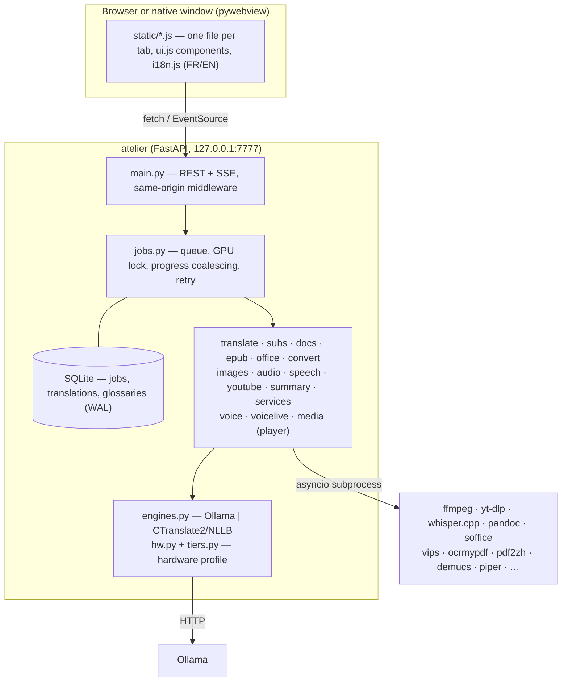

# Architecture

Atelier is a small FastAPI service (`atelier/`) plus a static, build-free UI (`static/`). Everything heavy is
delegated to existing command-line tools or local models; Atelier orchestrates, queues and reports progress.



## Job lifecycle

1. The UI uploads files to `data/uploads` (`POST /api/upload`) and submits `POST /api/jobs {kind, params}`.
2. `Manager.submit` inserts a row and starts a task. GPU jobs take the **global GPU lock**; models that no
   longer fit are unloaded first (`frees_vram`). CPU-heavy jobs share one slot (`HEAVY`).
3. Handlers report progress with `ctx.set(progress, message)` (coalesced to ~4 updates/s) and stream text
   with `ctx.delta`. Every subprocess goes through `proc.run_cmd`, which kills the whole process group on
   cancel and writes the full output to a per-job log.
4. On success the uploaded inputs are deleted unless another active job still reads them; on failure or
   cancel they are kept so **Retry** works. A janitor purges old uploads, logs and temporary files.

## Voice changer and in-app player

- **Voice (`voice.py`)**: catalogue of zero-shot voices (a reference `.wav` per voice, generated locally with Piper by
  `scripts/voice-refs.sh`, plus user-added voices with a mandatory rights checkbox) and DSP effects (`voicedsp.py`,
  ffmpeg filters). File jobs run demucs (vocals/accompaniment) → Seed-VC `inference.py` (subprocess, venv from
  `scripts/voice-setup.sh`) → optional DSP post → remix → wav/mp3/flac/mkv.
- **Live (`voicelive.py` + `voicelive_worker.py`)**: a long `voice_live` job holds the GPU lock. It starts
  `pw-loopback` (virtual mic "Micro Atelier (voix)") and a worker that reads the mic with `parec`, converts blocks
  with Seed-VC and plays to the loopback sink with `pacat`; the UI only sends JSON controls and polls stats.
  The worker is GPL-3.0 (derived from Seed-VC's `real-time-gui.py`). Without Seed-VC, effects run as an ffmpeg
  pulse→pulse chain.
- **Player (`media.py`, `static/player.js`)**: `ffprobe` decides whether the web view can play a result as is;
  otherwise a `preview` job writes a cached H.264/AAC mp4 (or m4a). `/api/jobs/{id}/stream` serves with HTTP
  Range, subtitles are served as VTT, and mpv is the external fallback. Files must be job outputs inside the
  output directory.

## Engines and hardware

`hw.py` reads GPU (AMD sysfs / `nvidia-smi`), RAM, cores and AVX2. `tiers.py` maps that profile to a tier and
recommended models per role (translate, text, vision). `engines.pick()` chooses between **Ollama** (prompted,
numbered batches) and **CTranslate2 + NLLB-200** (segment by segment, CPU) — only among what is already
installed, never downloading anything. Explicit values in `config.toml` always win.

## Translation fidelity

- Subtitles: SRT parsed and rebuilt in Python; the model only sees numbered lines, in batches with the
  previous batch as context, validated for count and retried/split on mismatch.
- Office/EPUB: paragraphs with several formats are sent with `<b> <i> <aN>` tags and `⟦n⟧` markers for
  non-translatable atoms (images, line breaks, footnote refs, code); invalid output falls back to plain text.
- PDF: delegated to pdf2zh-next (BabelDOC) with Ollama as backend.

## Windows

`atelier/plat.py` is the only place that knows the OS: process groups vs `taskkill /T`, `explorer`/`os.startfile`, VRAM and RAM
via PowerShell registry/perf counters + ctypes, Linux→Windows path remap applied to the whole config at load.
`atelier/winlaunch.py` is the exe entry point (uvicorn in a thread + pywebview, browser/Tk box fallback, `ATELIER_NO_WINDOW=1`
for CI). `ATELIER_FAKE_WIN=1` flips the argv/kwargs decisions on Linux so smoke23 can test them.

## Security

Loopback only; `Host` must be local and `Origin` must equal the request's own origin; `/api/*` refuses
`Sec-Fetch-Site` other than same-origin. Uploaded paths are resolved and confined to the uploads directory;
outputs are confined to `~/Atelier`. Subprocesses always receive argument lists (never a shell); untrusted
documents are read with pandoc's `--sandbox` into an AST first.

## VERT (in-browser conversion)

`scripts/build-vert.sh` builds [VERT](https://github.com/VERT-sh/VERT) (AGPL-3.0, pinned `VERT_REF`) from source with
offline patches (base `/vert`, local ffmpeg.wasm, no remote vertd, no service worker) into `<data>/vert`, which
`main.py` mounts on `/vert/` when present. Convertir shows it as the "Navigateur" mode: a same-origin iframe skinned
with Atelier's CSS variables (`static/vert.js`). Same origin means VERT's JS can call `/api`: that is why the build
is pinned and never fetched at runtime. Not bundled in the .deb/.exe (AGPL source obligations).

## Layout

```
atelier/    backend: one module per feature + jobs, db, proc, engines, hw
static/     index.html, one JS per tab, ui.js, i18n.js + i18n.en.js, style.css
scripts/    install helpers, desktop launcher, smoke tests
systemd/    user unit template        desktop/   .desktop template
docs/       this file and screenshots
```
