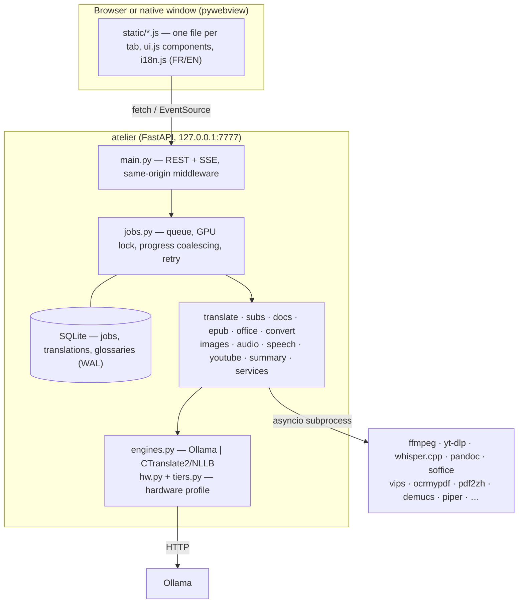

# Architecture

Atelier is a small FastAPI service (`atelier/`) plus a static, build-free UI (`static/`). Everything heavy is
delegated to existing command-line tools or local models; Atelier orchestrates, queues and reports progress.



## Job lifecycle

1. The UI uploads files to `data/uploads` (`POST /api/upload`) and submits `POST /api/jobs {kind, params}`.
2. `Manager.submit` inserts a row and starts a task. GPU jobs take the **global GPU lock**; models that no
   longer fit are unloaded first (`frees_vram`). CPU-heavy jobs share one slot (`HEAVY`).
3. Handlers report progress with `ctx.set(progress, message)` (coalesced to ~4 updates/s) and stream text
   with `ctx.delta`. Every subprocess goes through `proc.run_cmd`, which kills the whole process group on
   cancel and writes the full output to a per-job log.
4. On success the uploaded inputs are deleted unless another active job still reads them; on failure or
   cancel they are kept so **Retry** works. A janitor purges old uploads, logs and temporary files.

## Engines and hardware

`hw.py` reads GPU (AMD sysfs / `nvidia-smi`), RAM, cores and AVX2. `tiers.py` maps that profile to a tier and
recommended models per role (translate, text, vision). `engines.pick()` chooses between **Ollama** (prompted,
numbered batches) and **CTranslate2 + NLLB-200** (segment by segment, CPU) — only among what is already
installed, never downloading anything. Explicit values in `config.toml` always win.

## Translation fidelity

- Subtitles: SRT parsed and rebuilt in Python; the model only sees numbered lines, in batches with the
  previous batch as context, validated for count and retried/split on mismatch.
- Office/EPUB: paragraphs with several formats are sent with `<b> <i> <aN>` tags and `⟦n⟧` markers for
  non-translatable atoms (images, line breaks, footnote refs, code); invalid output falls back to plain text.
- PDF: delegated to pdf2zh-next (BabelDOC) with Ollama as backend.

## Security

Loopback only; `Host` must be local and `Origin` must equal the request's own origin; `/api/*` refuses
`Sec-Fetch-Site` other than same-origin. Uploaded paths are resolved and confined to the uploads directory;
outputs are confined to `~/Atelier`. Subprocesses always receive argument lists (never a shell); untrusted
documents are read with pandoc's `--sandbox` into an AST first.

## Layout

```
atelier/    backend: one module per feature + jobs, db, proc, engines, hw
static/     index.html, one JS per tab, ui.js, i18n.js + i18n.en.js, style.css
scripts/    install helpers, desktop launcher, smoke tests
systemd/    user unit template        desktop/   .desktop template
docs/       this file and screenshots
```
